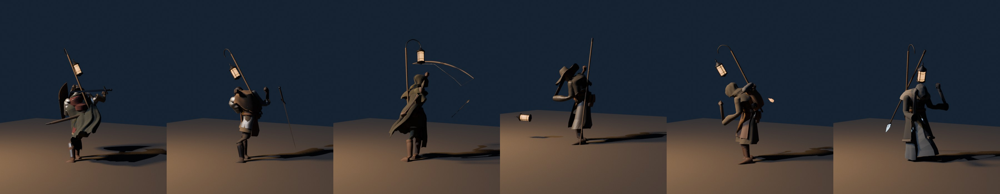
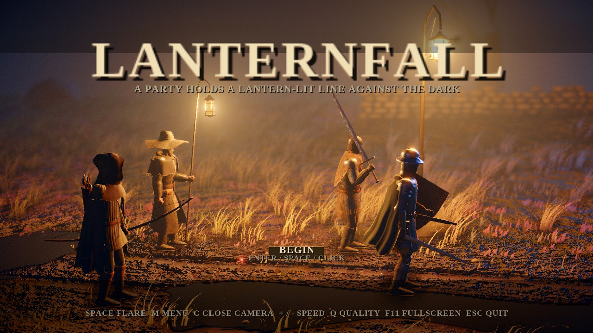
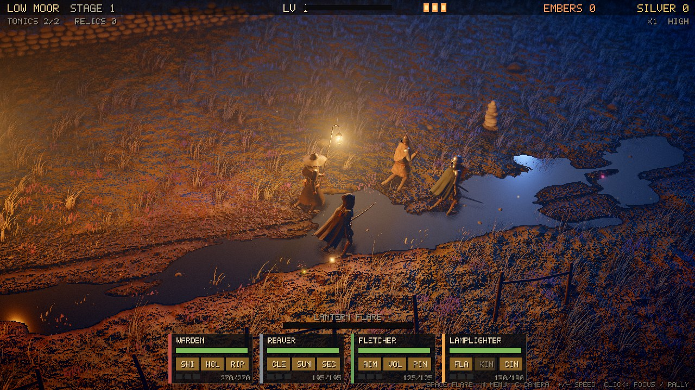

# LANTERNFALL — native C++ / OpenGL edition

A native desktop port of [loktar00/lanternfall](https://github.com/loktar00/lanternfall) (a single-page three.js idle battler): a party of heroes holds a lantern-lit line against waves of monsters that come out of the dark. Fights run on their own — you pick the cards, spend the loot and fire the lantern flare at the right moment.

**One ~0.8 MB executable. No installer, no asset files, no runtime dependencies besides a GPU driver with OpenGL 3.3.**

## Download

Grab the build for your OS from the [**latest GitHub Release**](https://github.com/NikitHamal/lanternfall/releases/latest):

| OS | File |
| --- | --- |
| Windows x64 | [`lanternfall-windows-x64.zip`](https://github.com/NikitHamal/lanternfall/releases/latest/download/lanternfall-windows-x64.zip) |
| Linux x64 | [`lanternfall-linux-x64.tar.gz`](https://github.com/NikitHamal/lanternfall/releases/latest/download/lanternfall-linux-x64.tar.gz) |
| macOS (Intel + Apple Silicon) | [`lanternfall-macos-universal.zip`](https://github.com/NikitHamal/lanternfall/releases/latest/download/lanternfall-macos-universal.zip) (unsigned: right-click → Open the first time) |

Unpack and run `lanternfall`. Progress (embers, boons, unlocks) is saved to `~/.lanternfall.sav` / `%APPDATA%\lanternfall.sav`.

## v1.2 - play the archer (3D)

Title screen: **STEWARD** (the original auto-battler), **PRACTICE RANGE** (static, sliding, bobbing and sweeping targets, zone scoring bullseye/inner/middle/outer/edge, combo) or **WAVE HUNT** (the monsters as ranged threats, boss every 5th wave, 3 flames).

| Input | Action |
| --- | --- |
| Mouse | look (pointer lock); in free-look: orbit |
| Hold LMB / release | draw (force curve, gold sweet spot) / loose; over-holding adds aim sway and drains stamina |
| RMB | raised-bow block (waves) |
| WASD, Shift, Space | move, sprint, dodge roll with i-frames (Ctrl also rolls) |
| V | cycle first person / third person / free-look showcase |
| G / B / R / Esc | arc assist toggle / auto-archer / restart / back to title |
| Wheel | zoom (third person, free-look) |

Arrows use gravity + quadratic drag with swept segment collision (foe capsules, target discs, props, terrain); the faint arc preview uses the same integrator. Death effects follow the reference (shatter, burn, burst, gutter).

## Controls (steward mode)

| Input | Action |
| --- | --- |
| Enter / Space / click | Start (title screen) |
| Space | Fire the Lantern Flare (when the meter is full) |
| M / Esc | Camp menu (buy upgrades with silver, toggle the Steward autopilot) |
| 1 2 3 | Pick a level-up card / choose Push or Hold at a waylight / buy boons |
| C | Close camera |
| + / − | Game speed 1× / 2× / 4× |
| Click enemy | Focus fire · click ground: rally the party |
| Q | Cycle graphics quality (Low / Medium / High / Ultra) |
| F11 / F10 | Fullscreen / toggle VSync |

Command line: `lanternfall --quality 0-3 --size W H --novsync --mute`.

## What is ported from the three.js original

* **Simulation** (`61-game.js` → `src/game.cpp`): fixed 60 Hz step, walk / fight / boss / breather / relight / choice / wipe state machine, all 6 hero classes with 3 skills each and their AI, 9 monsters incl. the 3 bosses (sweep / slam / charge telegraphs, enrage), gear grades & relics, cards, camp upgrades, ember boons (meta progression), the Steward autopilot with countdowns, flare, tonics, hit-stop, slow-mo, screen shake. Tuning constants are identical.
* **World** (`30-world.js`): the periodic winding road `pathZ`/`terrH`, the procedural ground shader (road ruts, hoof prints, mud, puddles/water, pebbles), 8 600 clumps of wind-animated GPU-instanced grass, the sky shader (clouds, stars, moon), 5 reaches (Low Moor, Drowned Fen, Barrow Downs, Thornwood, Ashen Tor) with their palettes / fog / prop mixes, procedurally generated rocks, standing stones, trees, cairns, dry-stone walls, fences and the iron waylight lantern, chunked world streaming.
* **Lighting**: hemisphere + moon (soft PCF shadow map) + fill + dynamic lantern point light (three.js distance/decay falloff, flicker, flare surge) + waylights + flash light, GGX specular, analytic night-sky environment for metals.
* **Post chain** (`40-post.js`, shaders ported line by line): MSAA HDR `RGBA16F` scene → screen-space AO + exponential height fog with moon glow + closed-form point-light in-scatter → 4-level bloom pyramid → depth of field + AgX tone map + colour grade, vignette, S-curve and film grain.
* **FX** (`50-fx.js`): embers, sparks, dust, chips, frost, flash lights, expanding rings, ground telegraphs, burning/frost zones, projectiles (arrow, ember, flask, lance, gloam bolt, cinderfall), floating combat text, loot motes, drifting dust motes and drizzle.
* **Camera** (`90-main.js`): fov 30° spring-damped follow, group framing zoom, boss wind-up pull-back, title orbit, relight framing, close camera, depth-of-field focus tracking.
* **Audio**: every SFX plus the wind bed, drone, danger pulse and campfire crackle is synthesised in the audio callback (miniaudio) — zero samples shipped.

### Honest differences
* The original's rigged, hand-modelled characters are replaced by animated stylised figures built from instanced primitives (walk, attack, cast, stagger, down, death poses). Props are procedural meshes like the original, with simplified generators.
* The original's embedded 2.5 MB music playlist is replaced by the procedural drone/wind bed. Offline "away" progress and the DOM portrait canvases were not ported. UI uses a built-in 5×7 pixel font.
* The lantern casts no point-light shadow cubemap (the moon casts shadows).

## Architecture

```
src/gl.h        hand-written GL 3.3 loader (glfwGetProcAddress) – no GLAD, no system GL link
src/mathx.h     vec/mat/noise/rng – no GLM
src/data.h      classes, monsters, cards, camp, boons, reaches (ported data tables)
src/game.*      deterministic simulation, fixed pools, no heap use per step
src/fx.*        6 000-slot particle ring, rings, floating text
src/meshes.*    procedural props + character part tables (merged static VBOs, instanced)
src/shaders.h   all GLSL (embedded in the exe)
src/render.*    world, camera, lights, FBO chain, post
src/ui.*        bitmap-font HUD in a single batched draw call
src/audio.*     procedural synth on miniaudio (vendored single header in third_party/)
```

* Everything is drawn with `glDrawElementsInstanced` / `glDrawArraysInstanced`: props, characters, grass blades, particles, ground marks and UI quads.
* No allocation in `update()` / `render()` / `step()`: units, monsters, projectiles, zones, loot, particles and instance buffers are fixed-capacity arrays.
* Render resolution scales with the quality preset (internal pixel budget 1.2 / 2.1 / 3.7 / 8.3 MP) and is upscaled to the window; works at 1080p/1440p/4K and fullscreen.

## Size & memory (measured)

| Metric | Value |
| --- | --- |
| Executable (Linux, `-O3`, stripped, GLFW static) | **~0.8 MB** |
| App-owned CPU memory (static pools + instance staging) | ≈ 4 MB |
| Cold start to first frame (llvmpipe software GL, no GPU) | < 1 s |
| Resident set on a *software* rasteriser (Mesa llvmpipe, Low preset, 1280×720) | ~180 MB — llvmpipe keeps every render target in system RAM; with a hardware GPU the render targets live in VRAM and the process RSS is dominated by the driver |

The original needs a browser (hundreds of MB) plus a 3.6 MB HTML file; the native build's own data is a few MB.

## Build from source

```sh
cmake -S . -B build -DCMAKE_BUILD_TYPE=Release && cmake --build build -j
./build/lanternfall
```
Needs CMake ≥ 3.16, a C++17 compiler, and on Linux `xorg-dev libxkbcommon-dev libgl1-mesa-dev`. GLFW 3.4 is fetched automatically.
For a headless smoke test: `xvfb-run ./build/lanternfall --demo --speed 30 --shot out.png --frames 120`.

## Credits
Game design, data and look: [loktar00/lanternfall](https://github.com/loktar00/lanternfall). This repository is an independent native re-implementation (not a fork). [GLFW](https://www.glfw.org/) (zlib), [miniaudio](https://miniaud.io/) (public domain / MIT-0).


## v1.1 - rebuilt characters
All six heroes and nine monsters are now the original three.js figures (same meshes, rigs, materials and animation) processed through a Blender pipeline (`tools/`):
skinned meshes with real armatures, baked ambient occlusion, GPU skinning and the original procedural surface shader. Run the game with the `assets/` folder next to the executable.




